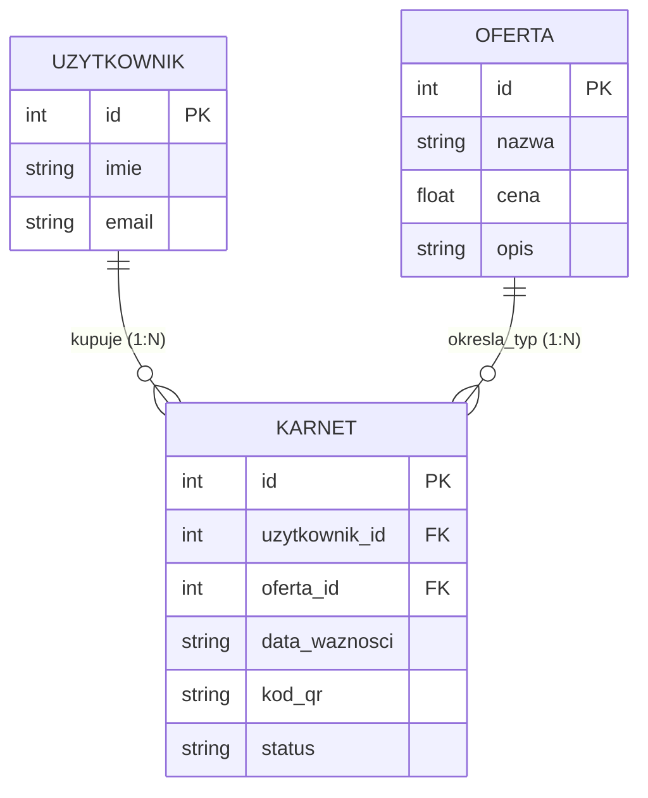

# Road Map projektu – Śnieżka SkiPass (Iteracja v1)

## 1. Cel i granice wersji v1
* **Tytuł projektu:** Śnieżka SkiPass – system rezerwacji i zakupu karnetów narciarskich
* **Główny odbiorca:** Klienci indywidualni oraz turyści planujący pobyt na stacji narciarskiej „Śnieżka”.
* **Najważniejszy cel v1:** Umożliwienie użytkownikowi przejrzenia oferty cenowej, zarezerwowania karnetu na wybrany dzień oraz zarządzania swoimi aktywnymi karnetami (w tym ich anulowania).

**Opis efektu dla użytkownika (v1):**
W pierwszej wersji aplikacji użytkownik może bez stania w kolejce do kasy zapoznać się z aktualnym cennikiem karnetów (np. Normalny, Ulgowy, Dziecięcy). Po wybraniu odpowiedniego wariantu oraz daty pobytu użytkownik tworzy rezerwację, a system automatycznie zapisuje karnet w bazie danych i nadaje mu unikalny kod oraz status „Aktywny”. Użytkownik ma stały wgląd w listę swoich karnetów i w razie zmiany planów może w każdej chwili anulować wybrany karnet jednym kliknięciem. Wersja v1 działa w oparciu o lokalnego użytkownika demonstracyjnego (nr 1), a funkcje takie jak rezerwacja sprzętu/instruktora (F04) oraz panel administratora (F05) zostają odłożone do kolejnej iteracji (v2).

### Powiązanie widoków, danych i funkcjonalności (MVP)

| Widok | Potrzebne dane | Funkcjonalność |
| :--- | :--- | :--- |
| **W01 Oferta karnetów** | `oferta` | **F01** Przeglądanie dostępnych karnetów i cennika. |
| **W02 Zakup karnetu** | `uzytkownik`, `oferta`, `karnet` | **F02** Rezerwacja/zakup wybranego karnetu na wskazany dzień. |
| **W03 Moje karnety** | `uzytkownik`, `oferta`, `karnet` | **F03** Przeglądanie zakupionych karnetów i anulowanie wybranego karnetu. |

---

## 2. Widoki – jak to ma wyglądać?

### W01: Oferta karnetów (Strona główna)
* **Kto korzysta i w jakim celu:** Klient – w celu sprawdzenia dostępnych rodzajów karnetów, ich opisów oraz cen za dzień.
* **Wyświetlane dane:** Lista pozycji z tabeli `oferta` (nazwa karnetu, opis, cena w zł).
* **Wprowadzane dane:** Brak (wyłącznie wybór przycisku przejścia do zakupu).
* **Komunikaty:** Informacja o dostępności oferty; w przypadku pustej bazy komunikat: *„Brak dostępnych ofert w cenniku”*.
* **Przejścia:** Przycisk `Kup karnet` przenosi do widoku **W02**; link w nawigacji `Moje karnety` przenosi do **W03**.

**Szkic widoku W01:**
```text
+-----------------------------------------------------------------------+
| [Logo] Śnieżka SkiPass       [W01: Oferta] [W02: Kup] [W03: Moje]     |
+-----------------------------------------------------------------------+
| Aktualny cennik karnetów narciarskich                                 |
|                                                                       |
| +-------------------------------------------------------------------+ |
| | Karnet Dorosły (Normalny)                         Cena: 79.00 zł  | |
| | Całodzienny dostęp do wszystkich wyciągów         [ Wybierz -> ]  | |
| +-------------------------------------------------------------------+ |
| | Karnet Student (Ulgowy)                           Cena: 59.00 zł  | |
| | Za okazaniem ważnej legitymacji                   [ Wybierz -> ]  | |
| +-------------------------------------------------------------------+ |
| | Karnet Dziecko                                    Cena: 39.00 zł  | |
| | Dla dzieci do 12 roku życia                       [ Wybierz -> ]  | |
| +-------------------------------------------------------------------+ |
+-----------------------------------------------------------------------+
```

---

### W02: Zakup karnetu (Formularz rezerwacji)
* **Kto korzysta i w jakim celu:** Klient – w celu zamówienia konkretnego karnetu na wybrany dzień jazdy.
* **Wyświetlane dane:** Lista wyboru rodzaju karnetu (z tabeli `oferta` wraz z ceną), pole wyboru daty ważności karnetu.
* **Wprowadzane dane:** Wybór pozycji oferty (`oferta_id`) oraz data ważności (`data_waznosci`).
* **Komunikaty:**
  * Po poprawnym działaniu: Przekierowanie do **W03** i zielony komunikat sukcesu: *„Karnet został pomyślnie zarezerwowany! Wygenerowano kod QR.”*
  * Po błędzie: Czerwony komunikat błędu na ekranie W02: *„Błąd: Wybierz rodzaj karnetu i podaj poprawną datę (data nie może być z przeszłości oraz nie możesz mieć dwóch takich samych aktywnych karnetów na ten sam dzień).”*
* **Przejścia:** Po zatwierdzeniu formularza przejście do **W03**; możliwość powrotu do **W01** przez menu nawigacji.

**Szkic widoku W02:**
```text
+-----------------------------------------------------------------------+
| [Logo] Śnieżka SkiPass       [W01: Oferta] [W02: Kup] [W03: Moje]     |
+-----------------------------------------------------------------------+
| [ Miejsce na komunikat błędu, np. "Wybrana data jest niepoprawna!" ]  |
|                                                                       |
| Zarezerwuj karnet                                                     |
|                                                                       |
| 1. Wybierz rodzaj karnetu:                                            |
|    [ Karnet Dorosły - 79.00 zł / dzień                         v ]    |
|                                                                       |
| 2. Data ważności karnetu (dzień pobytu na stoku):                     |
|    [ RRRR-MM-DD ]                                                     |
|                                                                       |
| [ Zarezerwuj i wygeneruj karnet ]            [ Anuluj / Powrót ]      |
+-----------------------------------------------------------------------+
```

---

### W03: Moje karnety
* **Kto korzysta i w jakim celu:** Klient – w celu sprawdzenia swoich zakupionych karnetów (kodu QR, daty, statusu) oraz ewentualnego anulowania rezerwacji.
* **Wyświetlane dane:** Lista karnetów przypisanych do użytkownika: nazwa z oferty, cena, `data_waznosci`, wygenerowany `kod_qr` oraz `status` (`Aktywny` lub `Anulowany`).
* **Wprowadzane dane:** Kliknięcie przycisku `Anuluj karnet` przy wybranej aktywnej pozycji.
* **Komunikaty:**
  * Po poprawnym działaniu: Komunikat: *„Karnet został anulowany.”* oraz zmiana statusu na liście na `Anulowany`.
  * Po błędzie: Komunikat: *„Błąd: Nie można anulować tego karnetu (karnet jest już anulowany lub nie należy do Ciebie).”*
* **Przejścia:** Nawigacja pozwala wrócić do **W01** (Oferta) lub **W02** (Nowy zakup).

**Szkic widoku W03:**
```text
+-----------------------------------------------------------------------+
| [Logo] Śnieżka SkiPass       [W01: Oferta] [W02: Kup] [W03: Moje]     |
+-----------------------------------------------------------------------+
| [ Komunikat sukcesu: "Operacja zakończona pomyślnie." ]               |
|                                                                       |
| Moje zakupione karnety (Użytkownik demo: Jan Nowak)                   |
|                                                                       |
| +-------------------------------------------------------------------+ |
| | Kod: QR-101 | Karnet Dorosły (79.00 zł) | Data: 2026-12-15        | |
| | Status: [ AKTYWNY ]                            [ Anuluj karnet ]  | |
| +-------------------------------------------------------------------+ |
| | Kod: QR-102 | Karnet Student (59.00 zł) | Data: 2026-12-10        | |
| | Status: [ ANULOWANY ]                                      (brak) | |
| +-------------------------------------------------------------------+ |
+-----------------------------------------------------------------------+
```

---

## 3. Struktura bazy danych – jakie dane zapisujemy?

Na potrzeby wersji v1 baza danych SQLite składa się z 3 powiązanych tabel zapewniających pełną obsługę procesów MVP.

| Tabela | Podstawowe pola i typy |
| :--- | :--- |
| **`uzytkownik`** | `id` (PK, liczba całkowita), `imie` (tekst), `email` (tekst) |
| **`oferta`** | `id` (PK, liczba całkowita), `nazwa` (tekst), `cena` (liczba zmiennoprzecinkowa), `opis` (tekst) |
| **`karnet`** | `id` (PK, liczba całkowita), `uzytkownik_id` (FK -> `uzytkownik.id`, liczba), `oferta_id` (FK -> `oferta.id`, liczba), `data_waznosci` (tekst / data `RRRR-MM-DD`), `kod_qr` (tekst), `status` (tekst: `'Aktywny'` lub `'Anulowany'`) |

### Schemat powiązań i krotności (ERD)
* Jeden **Użytkownik** może posiadać wiele **Karnetów** (relacja `1:N`).
* Jedna pozycja **Oferty** może dotyczyć wielu zakupionych **Karnetów** (relacja `1:N`).



---

## 4. Opis funkcjonalności (MVP) – co i jak ma działać?

### F01: Przeglądanie dostępnych karnetów i cennika
* **Użytkownik:** Klient
* **Powiązany widok:** W01 (Oferta karnetów)
* **Potrzebne dane:** Tabela `oferta` (`id`, `nazwa`, `cena`, `opis`)
* **Oczekiwane działanie:** Po wejściu na stronę główną (W01) system pobiera z bazy danych wszystkie dostępne pozycje cennika i wyświetla je w czytelnej liście wraz z przyciskiem umożliwiającym przejście do formularza zakupu.
* **Warunek poprawności:** Wszystkie rekordy z tabeli `oferta` są widoczne wraz z poprawnymi cenami w zł.
* **Sytuacja błędna / ograniczenie:** Jeśli w bazie nie ma jeszcze żadnych pozycji oferty, zamiast tabeli wyświetla się czytelny komunikat informacyjny, a przycisk zakupu jest nieaktywny.

### F02: Rezerwacja / zakup wybranego karnetu na wskazany dzień
* **Użytkownik:** Klient (działający jako lokalny użytkownik demonstracyjny nr 1)
* **Powiązany widok:** W02 (Zakup karnetu) -> przekierowanie do W03 (Moje karnety)
* **Potrzebne dane:** Tabele `uzytkownik`, `oferta`, `karnet`
* **Oczekiwane działanie:** Użytkownik w widoku W02 wybiera z listy rodzaj karnetu oraz datę pobytu i wysyła formularz. Serwer waliduje dane, generuje unikalny ciąg znaków `kod_qr`, zapisuje nowy rekord w tabeli `karnet` ze statusem `'Aktywny'` i wyświetla go na liście w widoku W03.
* **Warunek poprawności:** Wszystkie pola formularza są wypełnione, wybrana `data_waznosci` nie jest datą z przeszłości, a użytkownik nie posiada już innego **aktywnego** karnetu tego samego typu na ten sam dzień.
* **Sytuacja błędna / ograniczenie:** W przypadku pozostawienia pustego pola, podania daty wstecznej lub duplikatu aktywnej rezerwacji na ten sam dzień, system odrzuca zapis i wyświetla komunikat błędu w widoku W02.

### F03: Przeglądanie zakupionych karnetów i anulowanie wybranego karnetu
* **Użytkownik:** Klient (użytkownik demonstracyjny nr 1)
* **Powiązany widok:** W03 (Moje karnety)
* **Potrzebne dane:** Tabele `uzytkownik`, `oferta`, `karnet`
* **Oczekiwane działanie:** Użytkownik w widoku W03 widzi wszystkie swoje karnety. Kliknięcie przycisku `Anuluj karnet` przy aktywnej pozycji zmienia w bazie danych jej pole `status` z `'Aktywny'` na `'Anulowany'`. Anulowany karnet nie blokuje już ponownej rezerwacji na ten sam termin.
* **Warunek poprawności:** Karnet istnieje w bazie, należy do użytkownika demo nr 1 oraz posiada aktualnie status `'Aktywny'`.
* **Sytuacja błędna / ograniczenie:** Próba anulowania karnetu, który ma już status `'Anulowany'` lub nie istnieje, kończy się komunikatem błędu i brakiem zmian w bazie.

---

## 5. Mapa prac dla pierwszej iteracji (v1)

| Etap v1 | Osoba odpowiedzialna | Termin | Od czego zależy? | Oczekiwany rezultat |
| :--- | :--- | :--- | :--- | :--- |
| **1. Cel i zakres v1** | Michał i Radomił | Lab 02 | Koncepcja z Lab 01 | Zdefiniowany cel v1 i wybrane 3 funkcje MVP (F01–F03). |
| **2. Projekt widoków (W01–W03)** | Radomił | Lab 02 | Cel i zakres v1 | Opisy i szkice 3 widoków oraz zaprojektowana nawigacja. |
| **3. Struktura bazy danych** | Michał | Lab 02 | Dane potrzebne w widokach | Zdefiniowane 3 tabele (`uzytkownik`, `oferta`, `karnet`), klucze PK/FK i diagram ERD. |
| **4. Specyfikacja funkcjonalności** | Radomił | Lab 02 | Widoki i struktura bazy | Szczegółowy opis działania F01, F02, F03 oraz warunków walidacji. |
| **5. Sprawdzenie spójności mapy** | Michał | Lab 02 | Etapy 1–4 | Kompletny dokument `docs/roadmap-v1.md` w repozytorium GitHub. |

---

## 6. Kierunek kolejnej iteracji – rozwój w wersji v2

W kolejnej iteracji (v2) planujemy rozszerzyć system o dwa nowe obszary, przechodząc ponownie przez cykl: *Widoki -> Baza danych -> Funkcjonalności*.

### Pomysł 1: Filtrowanie oferty i podział na kategorie wiekowe/czasowe
* **Uzasadnienie celu:** Ułatwienie klientom szybkiego znalezienia odpowiedniego karnetu (np. tylko ulgowe lub wielodniowe) bez przeszukiwania całej listy.
* **Zmiany w widokach:** W widoku **W01** zostanie dodany pasek filtrów (wybór kategorii: *Wszystkie / Normalne / Ulgowe* oraz maksymalna cena).
* **Zmiany w danych:** W tabeli `oferta` zostanie dodane nowe pole `kategoria` (tekst) oraz `liczba_dni` (liczba całkowita).
* **Zmiany w funkcjonalnościach:** Rozbudowa funkcji **F01** o obsługę parametrów filtrowania przekazywanych w zapytaniu.

### Pomysł 2: Dodatkowe usługi – wypożyczenie sprzętu narciarskiego (Realizacja F04)
* **Uzasadnienie celu:** Kompleksowa obsługa turysty w jednym miejscu – możliwość dobrania nart lub kasku od razu przy zakupie karnetu.
* **Zmiany w widokach:** W widoku **W02** pojawi się dodatkowy checkbox/lista wyboru sprzętu do wypożyczenia, a w **W03** informacja o zarezerwowanym sprzęcie.
* **Zmiany w danych:** Dodanie nowej tabeli `sprzet` (`id`, `nazwa`, `cena_doba`, `dostepny`) oraz powiązanie jej z tabelą `karnet` kluczem obcym `sprzet_id`.
* **Zmiany w funkcjonalnościach:** Wdrożenie funkcji **F04** (rezerwacja usługi dodatkowej wraz z weryfikacją dostępności sprzętu).
